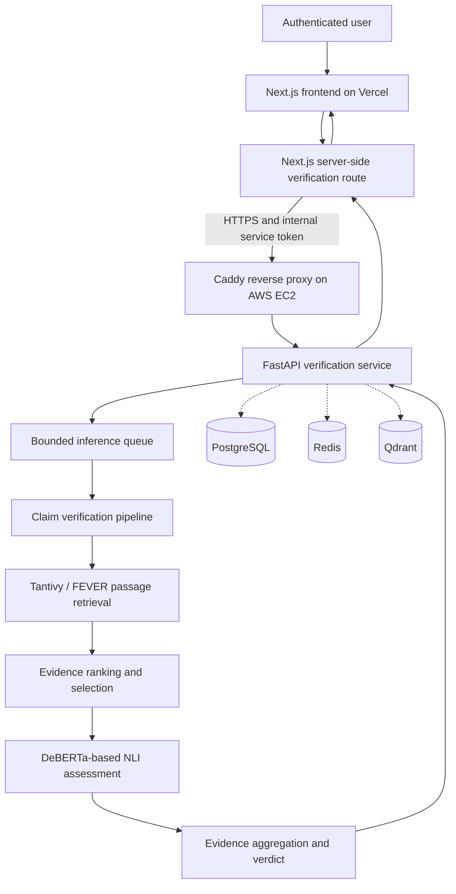

# Explainable News Verifier

**Evidence-first claim verification with auditable retrieval and natural-language inference**

[Live application](https://explainable-news-verifier.vercel.app) · [Source code](https://github.com/Aleem547/explainable-news-verifier)

## Overview

Explainable News Verifier is a full-stack AI system for assessing factual claims against a **FEVER/Wikipedia-derived evidence corpus**. Instead of returning an unexplained true/false score, it retrieves candidate passages, ranks relevant evidence, evaluates claim–evidence relations with a natural-language inference (NLI) model, and presents a traceable verdict with accepted and rejected evidence.

The currently deployed system supports four verdict categories: `SUPPORTING_EVIDENCE`, `REFUTING_EVIDENCE`, `CONFLICTING_EVIDENCE`, and `INSUFFICIENT_EVIDENCE`. **These are evidence-based assessments within the indexed corpus, not guarantees that a claim is true or false in the wider world.**

> **Scope and limitation:** The live deployment has been demonstrated with a Wikipedia-derived FEVER corpus. Independent, cross-publisher corroboration is **not yet established**. The system explicitly reports this limitation in its output. NLI scores are per claim–evidence pair and are not calibrated probabilities of claim truth.

## Live demonstration

- **Frontend:** https://explainable-news-verifier.vercel.app
- **Authentication:** Google sign-in is required for production verification.
- **API deployment:** FastAPI runs in Docker on AWS EC2 behind Caddy HTTPS. Backend service credentials are server-side only.
- **Public readiness endpoint:** `/api/v1/ready` is intentionally blocked at the public Caddy proxy; a public HTTP `404` does not indicate backend failure.

### Example functional checks

The following three end-to-end cases were observed through the deployed website. Times are illustrative **single-run latencies**, not benchmark averages.

| Claim | Observed evidence verdict | UI inference time |
| --- | --- | ---: |
| The Eiffel Tower is located in Paris. | Supporting evidence | 5.1 s |
| The Eiffel Tower is located in London. | Refuting evidence | 4.9 s |
| The Eiffel Tower contains a secret laboratory on its 200th underground floor. | Insufficient evidence | 8.2 s |

These examples confirm basic supporting/refuting/abstention behavior, but **do not establish model-wide accuracy, reliability, or calibration**.

## System architecture



*Dotted infrastructure links indicate provisioned service dependencies, not a claim that every verification request writes to or queries each service.*

### Verification workflow

1. **Claim input:** Accept and validate the text of a factual claim and requested evidence limit.
2. **Candidate retrieval:** Search the indexed FEVER/Wikipedia passages, including Tantivy-based retrieval.
3. **Evidence ranking:** Prioritize relevant candidate passages for assessment.
4. **NLI assessment:** Classify the relationship between each candidate passage and the claim (entailment, contradiction, or neutral).
5. **Acceptance and aggregation:** Apply decision rules and the current `0.90` decisive-evidence threshold; distinguish accepted evidence from neutral or below-threshold passages.
6. **Explainable output:** Return a verdict, page references, per-passage relationships and scores, accepted/rejected evidence, and warnings about provenance and corroboration.

## Technology stack

| Area | Main components |
| --- | --- |
| Frontend | Next.js 16, React 19, TypeScript, Tailwind CSS, Auth.js / NextAuth |
| Backend | Python 3.12, FastAPI, Pydantic, Uvicorn |
| Verification ML | Transformers / DeBERTa-based NLI, Sentence Transformers, evidence aggregation |
| Retrieval | Tantivy BM25 index; embedding and reranking model artifacts used by the retrieval pipeline |
| Infrastructure | Docker Compose, AWS EC2, Caddy HTTPS |
| Supporting services | PostgreSQL, Redis, Qdrant |
| Experimentation and quality | MLflow, pytest, Ruff, mypy; additional pipeline tools as defined by the repository |

The production API performs CPU inference and uses a bounded, process-local queue to limit concurrent model execution and guard memory. Queue capacity is not a distributed rate-limit or scalability guarantee.

## Repository layout

```text
apps/api/           FastAPI routes, configuration, services and DB models
apps/web/           Next.js frontend, Auth.js and server-side API adapter
ml/                 Evidence retrieval, NLI and verification pipeline code
infra/docker/       Development/production Compose files and Caddy config
data/               Dataset metadata and data artifact layout
models/             Local model artifact layout (large weights may be excluded)
benchmarks/         Performance/quality benchmark assets
migrations/         Database migration files
scripts/            Operational and training scripts
tests/              Automated tests
docs/               Technical documentation
```

The directory descriptions reflect the project's organization. Large trained models, FEVER datasets, Tantivy indexes, and secrets are not fully reproducible from source control alone.

## Running locally — developer orientation

**Prerequisites:** Python 3.12, `uv`, Node.js compatible with Next.js 16, and Docker Desktop with Compose. CPU/memory/disk capacity is necessary for the ML models and retrieval index.

1. Clone the repository and read `.env.example` and the relevant `infra/docker` Compose configuration.
2. Create local environment files from the examples. Replace placeholder credentials; **never commit `.env`, `.env.production`, or authentication tokens**.
3. Provision PostgreSQL, Redis and Qdrant using the development Compose configuration.
4. Provision the required model weights, FEVER data, and Tantivy index at the configured paths. These large artifacts are not created merely by cloning the repository.
5. Start the FastAPI backend using the repository's runtime configuration, then start the Next.js app under `apps/web`.
6. Confirm the backend's internal readiness endpoint, sign in, and test the verification workflow.

For production, consult [`docs/PRODUCTION_DEPLOYMENT.md`](docs/PRODUCTION_DEPLOYMENT.md). **Do not run a production `docker compose up`, delete volumes, or rebuild on the live EC2 host merely to validate the README.** The deployed instance currently uses a separately preserved AWS runtime override.

## Configuration and security

The production web application uses server-only variables including:

- `API_BASE_URL`: HTTPS address of the AWS API proxy.
- `INTERNAL_API_TOKEN`: Service-to-service authentication token; must match AWS.
- `AUTH_SECRET`, `AUTH_GOOGLE_ID`, `AUTH_GOOGLE_SECRET`: Auth.js/Google sign-in credentials.
- `VERIFY_REQUIRE_LOGIN=true`: Require login for verification (production also enforces it in the route).

For secrets, use the Vercel Environment Variables UI and AWS instance environment configuration; never put them in `NEXT_PUBLIC_*` variables, source files, screenshots or documentation. The web API route enforces same-origin requests, validates input, and forwards authenticated requests server-side.

## API behavior

The authenticated backend endpoint is `POST /api/v1/verify`. A request takes a `claim` and a `top_k` (1–20). The website passes its request to the server-side Next.js route, which authenticates the user and then calls FastAPI. The public backend is **not** an unauthenticated direct-testing endpoint.

The response includes the claim, evidence verdict, retrieved/assessed passage counts, provenance and scoring information, and an explanatory warning. Error conditions can include missing authentication, overload, and unavailable model/index artifacts.

## Evaluation and honest limitations

**Confirmed in the live demo:** three representative requests produced supporting, refuting, and insufficient-evidence outcomes; evidence details and rejection reasons were visible; HTTPS and the server-side frontend/API integration were functional.

**Not established by these checks:** accuracy on an independently held-out test set, general web fact-checking, independent multi-source corroboration, global claim-truth probabilities, load-test performance, and production reliability under sustained traffic.

The current corpus may be stale, incomplete, or biased, and a lack of supporting evidence is not proof that a claim is false. Scores must always be interpreted with the accompanying evidence and limitations.

## Submission and demo

See [`docs/SUBMISSION_DEMO.md`](docs/SUBMISSION_DEMO.md) for a concise presentation walkthrough and acceptance checklist, and [`docs/PRODUCTION_DEPLOYMENT.md`](docs/PRODUCTION_DEPLOYMENT.md) for the AWS/Vercel deployment runbook.

## Project status

**Deployed functional demonstration.** The FEVER-based evidence verification workflow, secure frontend/backend integration and three illustrative end-to-end cases have been demonstrated. Independent cross-source corroboration and comprehensive accuracy/reliability evaluation remain future work.

---

This project is a research and engineering demonstrator. Its verdicts should not be treated as authoritative fact-checks without independent evidence review.
